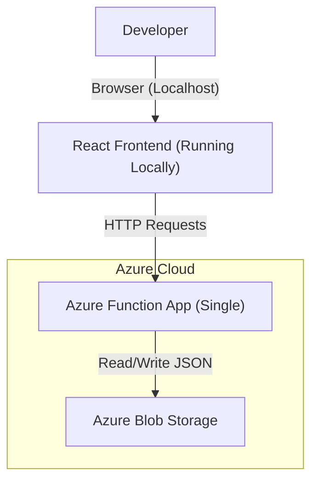

# Current State Architecture ("As-Is")

## Overview
This document represents the current, simplified development environment. It is designed for purely local testing and proof-of-concept work. It lacks security layer, scalability, and structured data storage.

## Architecture Diagram

## Component Breakdown

1.  **Frontend (Local)**:
    *   **Hosting**: None. Runs on the developer's machine (`npm run dev` at `localhost:3000`).
    *   **Connectivity**: Direct calls to the Azure Function URL.

2.  **Backend (Azure Functions)**:
    *   **Type**: Single Function App (likely HTTP Triggers).
    *   **Logic**: All scraping, search, and logic happens synchronously inside the HTTP request.
    *   **Authentication**: **None** (Anonymous access).

3.  **Data Storage (Blob)**:
    *   **Type**: Unstructured Storage (JSON files).
    *   **Usage**: Used for storing both the raw scraped data and the "database" records (e.g., `leads.json`).

## Key Limitations (Why we are moving to "To-Be")
*   **Security Risk**: No Authentication means anyone with the Function URL can access data.
*   **Data Integrity**: Using Blob Storage as a database leads to race conditions (two people saving at once overwrites data).
*   **Performance**: Long-running scrapes will time out the HTTP request since there is no Queue.
*   **Deployment**: The frontend is not accessible to other users/stakeholders.
