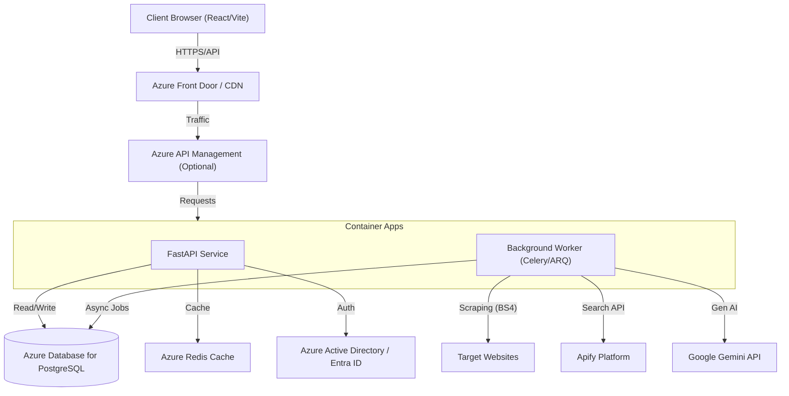
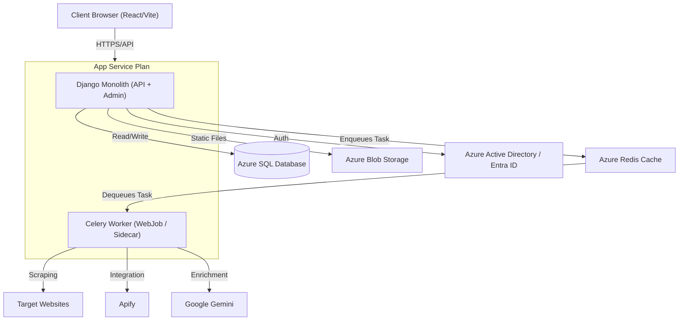
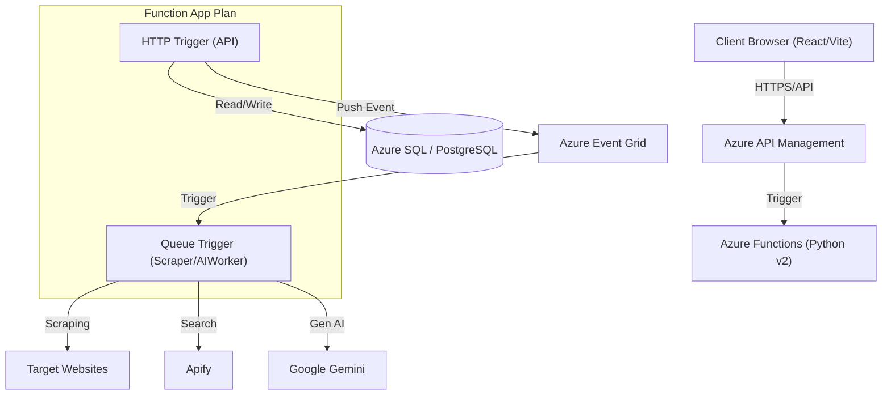

# Architecture Scenarios: Lead Generation Platform

This document outlines three proposed architecture scenarios for the Python-based backend.

## Common Components (All Scenarios)
*   **Frontend:** React + Vite (SPA)
*   **Database:** PostgreSQL (Recommended for relational lead data)
*   **Authentication:** OAuth2 / OIDC (Azure AD assumed, given corporate context)

---

## Scenario 1: The "Modern Performance" Stack
**Focus:** High concurrency, Async I/O, Microservice-ready.
*   **Framework:** **FastAPI** (Python)
    *   *Why:* Fast, auto-generated OpenAPI (Swagger) docs, Async support, great for APIs used by React.
*   **Deployment:** **Containers** (Docker)
    *   **Orchestration:** Azure Container Apps (serverless ctainers) or Kubernetes (if complex).
*   **Pros:** Modern, very fast, easy to scale, strict typing (Pydantic).
*   **Cons:** "Micro" framework implies you choose your own ORM (SQLAlchemy/Tortoise) and auth tools; slightly more initial boilerplate than Django.

## Scenario 2: The "Batteries Included" Stack
**Focus:** Rapid development, built-in Admin UI, stability.
*   **Framework:** **Django** (Python) + **Django REST Framework (DRF)**
    *   *Why:* Proven, huge ecosystem, built-in Admin panel (great for internal sales managers), robust ORM.
*   **Deployment:** **PaaS** (Azure App Service)
    *   *Why:* Easy to deploy "code", minimal infrastructure management.
*   **Pros:** Admin panel is free, security best practices largely built-in, "standard" way of doing things.
*   **Cons:** Slower/heavier than FastAPI (Sync by default), monolithic structure might be overkill if just a simple API.

## Scenario 3: The "Serverless/Event-Driven" Stack
**Focus:** Cost optimization, scaling to zero, event triggers.
*   **Framework:** **Azure Functions** (Python Programming Model v2)
*   **Deployment:** **Serverless Consumption Plan**
*   **Pros:** Pay per execution, excellent integration with other Azure services (Event Grid, Queues).
*   **Cons:** Cold starts, statelessness complexity, vendor lock-in, hard to manage connection pools (DB) without careful design.

---

---

## Architecture Diagrams

### Scenario 1: FastAPI + Container Apps (High Performance)

### Scenario 2: Django + App Service (Rapid Development)

### Scenario 3: Serverless (Event Driven)

## Data Flow: Smart Lead Generation (Updated)
1. **User** initiates "Enrich Lead" or "Find Leads" from Frontend.
2. **Backend** creates a Job ID and enqueues it (Redis/Queue).
3. **Backend** returns `202 Accepted` + `JobID` to Frontend.
4. **Worker/Function** picks up the job:
    *   **Phase 1 (Search):** Query **Apify** or Scrape **Sites (BS4)** to gather raw text.
    *   **Phase 2 (Process):** Send raw text to **Google Gemini** for summarization/extraction.
    *   **Phase 3 (Save):** Store structured result in **Database**.
5. **Frontend** polls `GET /jobs/{id}` or receives WebSocket update.

