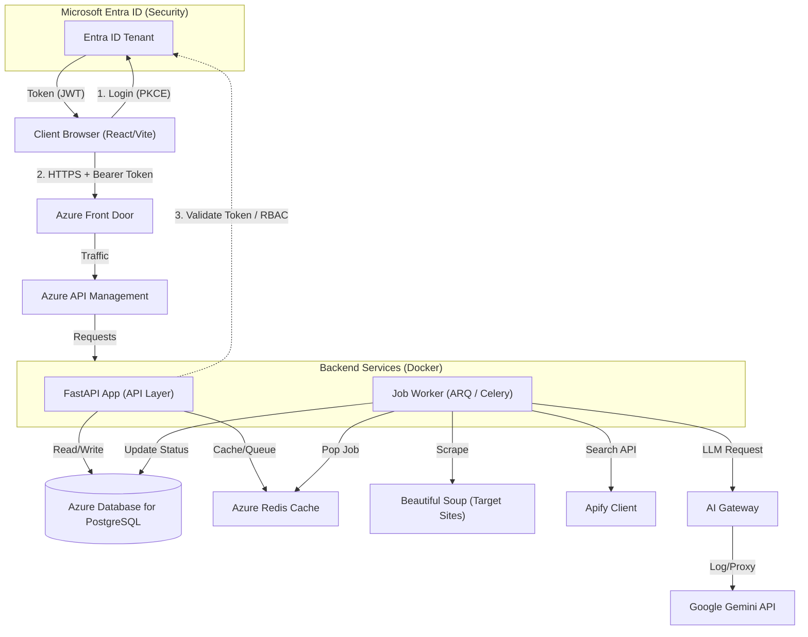

# Scenario 1: High Performance Microservices (FastAPI + Containers)

## Overview
This architecture prioritizes **performance, high concurrency, and scalability**. It uses **FastAPI**, a modern Python framework built on standard Python type hints and the `async/await` pattern, making it ideal for I/O-bound tasks like orchestrating multiple external API calls (Apify, Gemini) simultaneously.

## Architecture Diagram

## Identity & Security (Microsoft Entra ID)
*   **Authentication (AuthN)**: The React Frontend uses MSAL.js to sign users in via **OIDC** (Authorization Code Flow with PKCE).
*   **Authorization (AuthZ)**:
    *   **FastAPI Middleware**: Validates the JWT Bearer Token on every request.
    *   **RBAC**: We map Entra ID **App Roles** (e.g., `LeadGen.Reader`, `LeadGen.Admin`) to scopes. Even if valid, a user without `LeadGen.Admin` cannot trigger a scrape job.

## Component Breakdown

1.  **AI Gateway (New)**:
    *   **Role**: Centralized entry point for all LLM calls.
    *   **Benefits**: Logs token usage, handles rate limiting, caches responses (optimizing costs), and allows easy swapping of models (Gemini -> GPT-4) without changing application code.

1.  **API Layer (FastAPI)**:
    *   **Role**: Handles User Auth, validation (Pydantic), and request acceptance.
    *   **Key Feature**: Auto-generated API Docs (Swagger UI) for the Frontend team.
    *   **Async Native**: Can handle thousands of 'waiting' connections (e.g., waiting for a quick search result) without blocking.

2.  **Async Worker (ARQ or Celery)**:
    *   **Role**: Handles ALL long-running tasks (Scraping, AI).
    *   **Reasoning**: "Fire and forget." The User doesn't wait 30s for a scrape. They get a Job ID.
    *   **Scalability**: You can scale the `Worker` container independently of the `API` container based on queue size.

3.  **Data Layer**:
    *   **PostgreSQL**: Stores structured Lead data, User info, and Job status logs.
    *   **Redis**: Serves as the **Task Queue** (Broker) and high-speed cache for session data.

## Deep Dive: Smart Lead Enrichment Flow

This specific flow leverages the "Async" nature of the stack.

1.  **Request**: User clicks "Enrich Lead" on React UI.
2.  **Queue**: FastAPI validates the request and pushes a `enrich_lead_task` to Redis.
3.  **Response**: Returns `202 Accepted` with `{"job_id": "123"}` instantly.
4.  **Execution (Worker)**:
    *   **Step A (Search)**: Worker picks up the task. Calls **Apify** to find the Lead's LinkedIn/Company page.
    *   **Step B (Scrape)**: If a specific URL is found, uses **BeautifulSoup** to extract raw text (About Us, Pricing).
    *   **Step C (AI)**: Sends the gathered raw text to **Google Gemini**. Prompt: *"Summarize this company profile and estimate deal size."*
    *   **Step D (Save)**: Updates PostgreSQL record `Lead #55` with the new insights and marks Job #123 as `COMPLETED`.
5.  **Notification**: Frontend polls backend or receives a WebSocket message that Job #123 is done, then re-fetches the Lead data.

## Infrastructure Requirements (Azure)

| Resource | Service | SKU (Est.) |
| :--- | :--- | :--- |
| **Frontend** | **Azure Static Web Apps** | **Standard** (Req. for Custom Entra Tenant Policy) |
| **Compute** | Azure Container Apps | Consumption (Scale to Zero) |
| **Database** | Azure Database for PostgreSQL | Flexible Server (B1ms) |
| **Cache/Broker** | Azure Cache for Redis | Basic C0 |
| **Identity** | Microsoft Entra ID | Free / P1 |
| **Storage** | Azure Blob Storage | Standard LRS (Logs/Exports) |

## Pros & Cons

*   **Pros**: 
    *   Highest performance for I/O tasks.
    *   Strict typing (Pydantic) reduces bugs.
    *   Independent scaling of API vs. Workers.
*   **Cons**:
    *   More operational complexity (Managing Dockerfiles, multiple container revisions).
    *   Requires setting up a separate Worker process explicitly.
