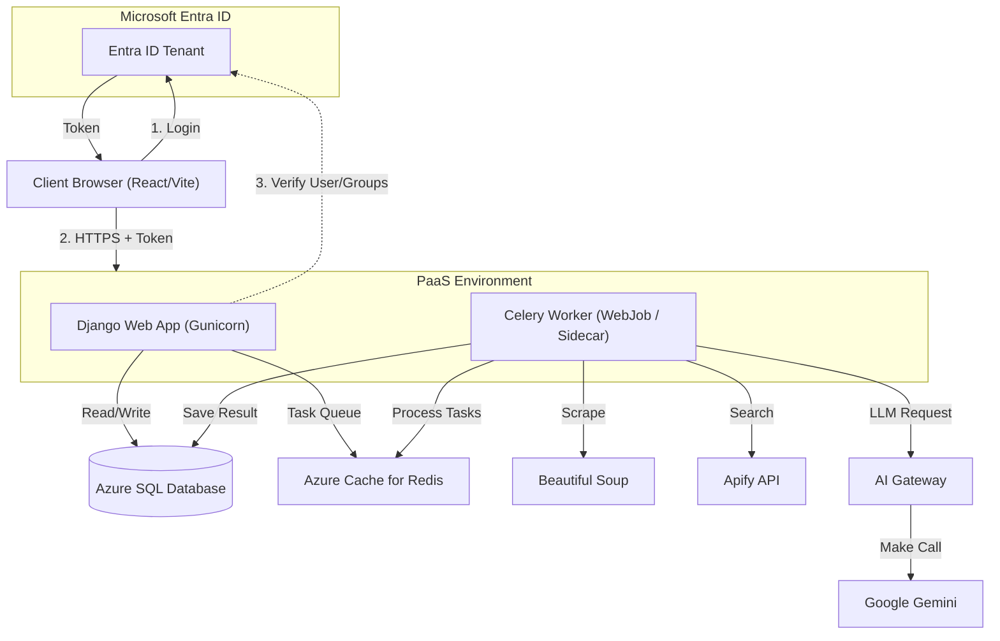

# Scenario 2: Rapid Development Monolith (Django + App Service)

## Overview
This architecture optimizes for **development speed and stability**. It uses **Django**, the "batteries-included" framework. This is often the best choice for teams that need to deliver complex business logic (Auth, Admin Interfaces, ORM) quickly without reinventing the wheel.

## Architecture Diagram

## Identity & Security (Microsoft Entra ID)
*   **Authentication**:
    *   **Frontend**: React uses MSAL.js.
    *   **Backend (Easy Auth)**: We can enable "App Service Authentication" to handle JWT validation *before* the request even hits Django.
*   **Authorization**:
    *   **Django Groups**: Map Entra ID **Security Groups** (e.g., `SG_Sales_Managers`) to Django Groups during login.
    *   **Admin Panel**: Only users with `is_staff=True` (mapped from an Entra Group) can access the Admin UI.

## Component Breakdown

1.  **AI Gateway (New)**:
    *   **Role**: Middleware or dedicated service to manage LLM interactions.
    *   **Observability**: Provides a dashboard to see exactly how much each scraping job costs in token usage.

1.  **Web Layer (Django + DRF)**:
    *   **Role**: Serves the REST API (via Django REST Framework) and the **Internal Admin Panel**.
    *   **Key Feature**: **Django Admin**. This is a huge win for Sales Ops who need to view/edit data manually without a custom Frontend page.
    *   **Authentication**: Uses standardized libraries (`django-auth-adfs` or `msal`) for Azure AD integration.

2.  **Task Queue (Celery)**:
    *   **Role**: Distributed task queue to handle the heavy lifting (Scraping/AI).
    *   **Integration**: Tightly integrated with Django ORM. Passing database objects to tasks is trivial.

3.  **Data Layer**:
    *   **Azure SQL**: Django supports MSSQL well (via `mssql-django`), aligning with many enterprise stacks.
    *   **Redis**: Essential for Celery brokering.

## Deep Dive: Smart Lead Enrichment Flow

Django handles this synchronously until the handoff to Celery.

1.  **Request**: User clicks "Enrich" on UI.
2.  **Django View**: 
    *   Checks permissions (Is user a Manager?).
    *   Creates a `TaskResult` record in the DB (status='PENDING').
    *   Calls `enrich_lead.delay(lead_id=55)`.
3.  **Celery Worker**: 
    *   Receives the task ID.
    *   **Step A**: Fetch `Lead(id=55)` from DB.
    *   **Step B**: Call **Apify** to get the URL.
    *   **Step C**: Scrape content with **BeautifulSoup**.
    *   **Step D**: Call **Gemini** to summarize.
    *   **Step E**: Save result to `Lead` model.
4.  **Admin Visibility**: A developer or manager can log into the /admin panel and see the status of all Celery tasks and their results natively.

## Infrastructure Requirements (Azure)

| Resource | Service | SKU (Est.) |
| :--- | :--- | :--- |
| **Frontend** | **Azure Static Web Apps** | **Standard** (Req. for Custom Entra Tenant Policy) |
| **Hosting** | Azure App Service (Linux) | B1 / P1v2 |
| **Database** | Azure SQL Database | Standard S0 |
| **Cache/Broker** | Azure Cache for Redis | Basic C0 |
| **Storage** | Azure Blob Storage | Standard LRS (Static Assets) |

## Pros & Cons

*   **Pros**: 
    *   **Speed**: Admin panel is free. User management, groups, and permissions are built-in.
    *   **Stability**: Mature ecosystem.
    *   **Easy Handoff**: Most Python devs know Django structure.
*   **Cons**:
    *   **Performance**: Slightly slower (Sync) than FastAPI, though async support is improving.
    *   **Monolith**: Can become bloated. Scaling requires scaling the entire App Service Plan.
