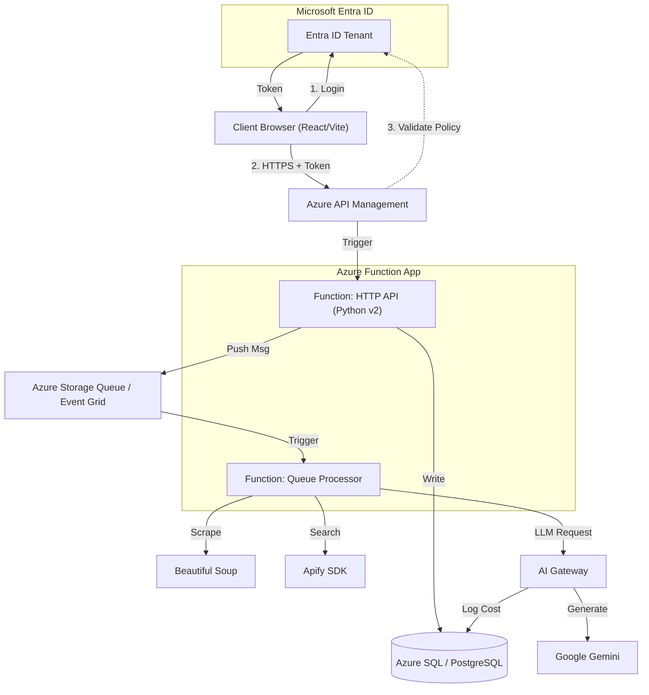

# Scenario 3: Event-Driven Serverless (Azure Functions)

## Overview
This architecture optimizes for **cost efficiency and high scalability**. It creates a loosely coupled system where "API" and "Workers" are just individual functions that scale to zero when not in use. This is ideal if the scrapping/AI workload is "bursty" (e.g., uploading 1000 leads at once, then silence for hours).

## Architecture Diagram

## Identity & Security (Microsoft Entra ID)
*   **Authentication**: Handled at the **API Management (APIM)** layer or via **App Service Authentication** on the Function App.
*   **Authorization (Policies)**:
    *   **APIM Policy**: We write a policy `<validate-jwt>` to check specific Claims (roles/groups). If the user isn't in `SalesGroup`, request is rejected *before* typically hitting the Function, saving cost.
    *   **Function Level**: The function code assumes the configured identity is valid and focuses on business logic.

## Component Breakdown

1.  **AI Gateway Pattern**:
    *   Even in serverless, you should route LLM calls through a governed endpoint.
    *   Ensures that if 1,000 parallel functions fire, you can apply rate-limiting at the Gateway so you don't hit Gemini's quota immediately.

1.  **API Functions (HTTP Triggers)**:
    *   **Role**: Simple endpoints (`get_leads`, `create_lead`) that act as the API.
    *   **Scaling**: Azure scales these automatically based on incoming HTTP requests.

2.  **Worker Functions (Queue Triggers)**:
    *   **Role**: Listens to an Azure Storage Queue. When a message arrives (`{"lead_id": 55}`), it wakes up and runs.
    *   **Benefit**: If you upload 10,000 leads, Azure spins up 100+ instances of this function to process them in parallel automatically.

3.  **Data Layer**:
    *   **Azure SQL / PostgreSQL**: Standard relational storage.
    *   **Storage Queues**: Replaces Redis. Much cheaper and simpler for basic "do this work" messages.

## Deep Dive: Smart Lead Enrichment Flow

1.  **Request**: Frontend POSTs `leads/batch-upload`.
2.  **API Function**: 
    *   Validates upload.
    *   Inserts 100 leads into DB.
    *   Pushes 100 messages to `lead-enrichment-queue`.
    *   Returns `200 OK`.
3.  **Queue Processor (Worker)**:
    *   Azure detects 100 messages. Spins up X instances of `EnrichmentFunction`.
    *   **Instance 1**: Picks up Lead #1.
    *   **Executes**: Apify Search -> BS4 Scrape -> Gemini Encichment.
    *   **Saves**: Writes back to DB.
    *   **Dies**: Instance shuts down after work is done.

## Infrastructure Requirements (Azure)

| Resource | Service | SKU (Est.) |
| :--- | :--- | :--- |
| **Frontend** | **Azure Static Web Apps** | **Standard** (Req. for Custom Entra Tenant Policy) |
| **Compute** | Azure Functions | Consumption Plan (Y1) |
| **Database** | Azure SQL / PostgreSQL | Flexible Server |
| **Queue** | Azure Storage Account | Standard LRS (Pennies/month) |
| **API Gateway** | Azure API Management | Consumption Tier |

## Pros & Cons

*   **Pros**: 
    *   **Cost**: You pay almost nothing when idle.
    *   **Scale**: Easiest way to handle "bursts" of scraping tasks.
    *   **Maintenance**: No OS upgrades, no Dockerfile management (unless using custom containers).
*   **Cons**:
    *   **Cold Starts**: The API might take 2-3 seconds to respond after being idle.
    *   **Development Experience**: Debugging local functions + queues is harder than a standard Django/FastAPI app.
    *   **Timeouts**: Functions have execution time limits (typ. 5-10 mins).
